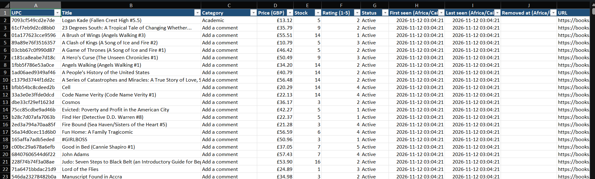
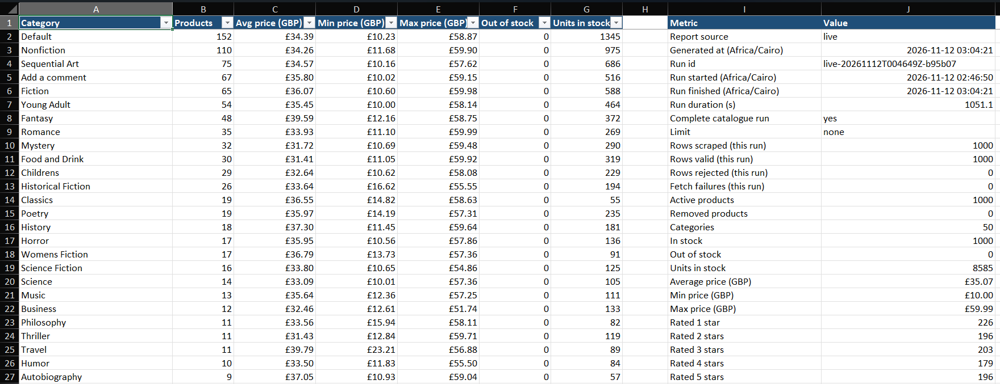
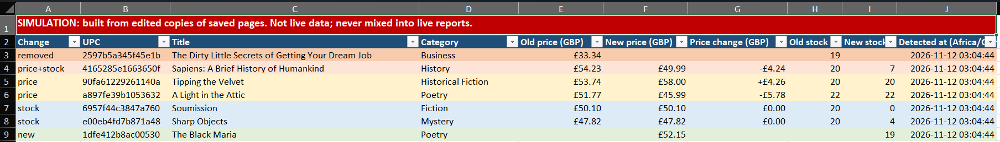
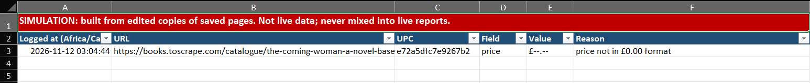

# P6 · Web Scraping Pipeline

Scrapes products and prices from **practice websites built for scraping**, cleans and validates them, stores them in PostgreSQL with price/stock history, and produces a formatted Excel report plus CSV. Runs are scheduled, and the pipeline tracks what changed between runs.

**Stack:** Python 3.14 · requests + BeautifulSoup/lxml · Playwright (headless Chromium) · PostgreSQL 16 (Docker) · openpyxl · pytest · cron / systemd timer · GitHub Actions

## Ethics & legality

- **Only practice sites are scraped.** Both targets were built to be scraped:
  - [books.toscrape.com](https://books.toscrape.com): 1,000 fictional books. Every page carries this notice: *"This is a demo website for web scraping purposes. Prices and ratings here were randomly assigned and have no real meaning."*
  - [quotes.toscrape.com/js/](https://quotes.toscrape.com/js/): a JavaScript-rendered sandbox from the same project.
- **How robots.txt is handled:** it is fetched once per host before any page is requested.
  - **404 or another 4xx** means no rules, so every path is allowed. This is the standard behavior (RFC 9309). Both sites return 404 as of 2026-11.
  - **5xx or unreachable** means everything on that host is treated as disallowed, which is the conservative choice.
  - **A disallowed path** is skipped and logged. It is never fetched.
- **Rate limit:** there is a fixed delay between requests (`SCRAPER_DELAY_SECONDS`, 1 s by default).
- **Retries** use exponential backoff and apply only to timeouts, connection errors, 429 and 5xx. Every request has a timeout.
- **User-Agent:** a clear one that identifies the project. The scraper never pretends to be a browser.
- **No personal data** is collected.

## Architecture

```
crawl (robots, rate limit, retries, checkpoint) -> parse -> clean/validate -> detect changes
      -> PostgreSQL (one transaction per run) -> Excel / CSV (live-only by default)
```

| Module | Role |
|---|---|
| `scraper/http.py` | Polite fetcher. Always decodes as UTF-8, because the site sends no charset and `£` would otherwise become `£` |
| `scraper/books.py` | Parsers for list and detail pages |
| `scraper/clean.py` | Price to `Decimal` GBP, stock text to `int`, rating word to 1-5, trimming, dedupe by UPC, rejected rows with a reason |
| `scraper/changes.py` | Change detection (new, price, stock, price+stock, removed) with a separate baseline per source |
| `scraper/crawl.py` | Pagination, `--limit`, resume from staged rows, and the "complete run" rule |
| `scraper/state.py` | Atomic checkpoint plus staged raw rows, so a resumed run still has the whole catalogue |
| `scraper/db.py` | PostgreSQL schema and queries. `source` is part of every key, and reads default to `live` |
| `scraper/pipeline.py` | One run: crawl, clean, compare, then store everything in one transaction |
| `scraper/report.py`, `scraper/export.py` | Summary calculations (exact Decimals), Excel and CSV |
| `scraper/quotes_js.py` | Playwright scraper for the JavaScript site. Same politeness rules, through a `BrowserFetcher` subclass of the polite fetcher |
| `scraper/cli.py` | `init-db`, `scrape`, `export`, `run-all`, `quotes` |
| `scraper/timeutil.py` | Stores times in UTC and shows them in Africa/Cairo time |

## Data rules

- All timestamps are stored in **UTC**. The Excel report shows them in **Africa/Cairo** time.
- Every row has a `source` of `live` or `simulation`. Reports (All products, Summary, CSV) **include only `live` rows by default**, so simulated data never mixes into real numbers.
- A history row is written only when a product is first seen or when its price or stock changes.
- **Removed products** are flagged only after a **complete** run: no `--limit`, every list page reached, no failed or robots-skipped URL, and every rejected row still had a UPC. A resumed run counts only if it finishes the whole catalogue. Removed products get `removed_at` and are never deleted. A rejected row is *not* treated as removed.
- Invalid rows are never dropped silently. Each one goes to `import_log` and the **Import_Log** sheet with the field, the raw value and a reason.

### Database (PostgreSQL 16, container `p6-scraper-pg` on `127.0.0.1:5435`)

| Table | Purpose |
|---|---|
| `products` | Current state per `(source, upc)`: price, stock, rating, first/last seen, `removed_at` |
| `price_stock_history` | Append-only. A row is added only for a new product or a price/stock change |
| `change_log` | What changed in each run, including `removed` |
| `import_log` | Rejected rows and failed URLs, with reasons |
| `scrape_runs` | One row per run: timings, limit, whether it was complete, counts |

## Results

### Live run: books.toscrape.com (full catalogue, 2026-11-12)

| | |
|---|---|
| Rows scraped / valid / rejected | **1,000 / 1,000 / 0** |
| Fetch failures | 0 (on an earlier attempt, 2 connection timeouts on robots.txt were recovered by the retries) |
| Duration | **1,051 s (about 17.5 min)** at a 1 s delay: 50 list pages + 1,000 detail pages |
| Complete run | yes, so the removal check ran (0 removed) |
| Categories | 50 |
| Average price | **£35.07035** (exact; min £10.00, max £59.99) |
| Stock | 1,000 in stock, 0 out of stock, 8,585 units in total |
| Ratings 1 to 5 stars | 226 / 196 / 203 / 179 / 196 |
| Largest categories | Default 152 (avg £34.39), Nonfiction 110 (£34.26), Sequential Art 75 (£34.57) |

"Default" and "Add a comment" are real category names on the site and are kept as they are. Every Summary figure was cross-checked against independent SQL.




### Simulation (edited copies of saved pages, *not* live data)

Round 2 compared with round 1: **2 price changes, 2 stock changes (one sold out), 1 price+stock change, 1 new book, 1 removed book** (kept, with `removed_at` set), and **1 row rejected** ("price not in £0.00 format"). The live data stayed untouched: 1,000 products and 1,000 history rows before and after.




### JavaScript site: quotes.toscrape.com/js/ (Playwright)

10 pages rendered in 11.8 s. 100 quotes scraped, 100 valid, 0 rejected, 50 authors. Output goes to `outputs/csv/quotes/`.

### What testing caught

- **Silent rollback.** With psycopg 3 in non-autocommit mode, the baseline read opened an implicit transaction, so `conn.transaction()` became only a *savepoint*, and closing the connection rolled the whole run back. Inside the same connection everything looked correct, including the export and the first DB tests. It was caught when a full run reported "1000 new" even though a 5-book run had been stored just before. The fix is autocommit connections, where each `conn.transaction()` is a real BEGIN/COMMIT. Two regression tests now read through a **second connection**: one checks that a run is committed, and one checks that a failure halfway through storing leaves **no** partial rows.
- **Wrong encoding.** The site sends `text/html` with no charset, so `requests` guesses ISO-8859-1 and `£` becomes `£`. A test reproduces this from the saved bytes, the fetcher forces UTF-8, and any garbled price that slips through is rejected with a reason instead of being misread.

## Change-tracking demo (simulation)

books.toscrape.com prices never change, so `--simulate-changes` replays two rounds of **edited copies of saved pages** (`data/simulation/`, rebuilt with `scripts/build_simulation.py`). Round 2 has 2 price changes, 2 stock changes (one sold out), 1 price+stock change, 1 removed book, 1 new book and 1 invalid price.

- Simulated rows are stored with `source = 'simulation'`. They have their own baseline and never touch live rows.
- The simulation report is a separate file (`report_simulation_*.xlsx`) with a red **SIMULATION** banner on every sheet.
- Each replay resets only the simulation rows, so the demo can be repeated.

## Setup

```bash
python3 -m venv .venv
.venv/bin/pip install -r requirements.txt
cp .env.example .env      # then set POSTGRES_PASSWORD; .env is never committed
docker compose up -d      # p6-scraper-pg on 127.0.0.1:5435
.venv/bin/python -m scraper init-db
.venv/bin/pytest
```

## Usage

```bash
.venv/bin/python -m scraper run-all --limit 20          # quick run: 20 books, then Excel and CSV
.venv/bin/python -m scraper run-all                      # full catalogue (about 18 min at a 1 s delay)
.venv/bin/python -m scraper run-all --simulate-changes   # change-tracking demo (simulation report)
.venv/bin/python -m scraper scrape [--limit N] [--fresh] [--delay S]
.venv/bin/python -m scraper export [--source live|simulation] [--run-id RUN_ID]   # default: latest run
.venv/bin/python -m scraper quotes [--max-pages N]       # JavaScript site through headless Chromium
```

Playwright needs Chromium once: `.venv/bin/playwright install chromium`. On WSL/Ubuntu it also needs three system libraries: `sudo apt-get install -y libnss3 libnspr4 libasound2t64`.

- If a full run is interrupted, it exits with code 2 and keeps `outputs/state/live/checkpoint.json`. Running the same command again resumes it, and `--fresh` starts over.
- Outputs:
  - `outputs/reports/report_<source>_<UTC stamp>.xlsx` and `report_<source>_latest.xlsx`
  - `outputs/csv/<source>/{products,changes,import_log}_<source>.csv` (UTF-8 with BOM, times in UTC ISO-8601)
  - `outputs/logs/run_*.log`

### Excel report

| Sheet | Contents |
|---|---|
| All products | Every product with its £ price, stock, rating, Active/Removed status, and first/last seen and removed times (Africa/Cairo) |
| Changes since last run | new / price / stock / price+stock / removed, with old and new values and the £ difference, colour-coded |
| Summary | Per category: count, average/min/max price, out of stock, units. Also run facts and totals |
| Import_Log | Rejected rows and failed URLs, with the field, raw value and reason |

Every sheet has a frozen header, an autofilter, £ number formats and an explicit left-to-right layout (safe in Arabic/RTL Excel), and every time header names its timezone.

## Scheduling

**WSL.** Both options run `deploy/run_scheduled.sh`, which:
- waits for Docker Desktop, then starts `p6-scraper-pg` if it isn't running;
- takes a lock, so a slow run can't overlap the next trigger;
- runs `run-all`. An interrupted run exits 2 and the next trigger resumes it.

- **systemd user timer** (WSL with `systemd=true`): `deploy/systemd/p6-scraper.{service,timer}`. Runs Mondays at 03:00 UTC. `Persistent=true` catches up on a missed run when WSL starts.
  ```bash
  mkdir -p ~/.config/systemd/user && cp deploy/systemd/p6-scraper.* ~/.config/systemd/user/
  systemctl --user daemon-reload && systemctl --user enable --now p6-scraper.timer
  systemctl --user list-timers p6-scraper.timer
  ```
- **cron:** `deploy/cron.example` (cron uses the system timezone, Africa/Cairo on this machine).

**GitHub Actions** (`.github/workflows/scrape.yml`):
- Push or pull request: all tests run, including the DB tests (Postgres service container) and the offline browser test.
- Weekly (Mondays 03:00 UTC) or manual (*Run workflow*, optional `limit`, default 50): tests, then a live scrape, the simulation report and the quotes scrape. The Excel, CSV and log files are uploaded as the `scrape-report-<n>` artifact, kept for 30 days.
- **Why a Postgres service container instead of a `--no-db` mode:**
  - CI runs exactly the same code path as WSL: the schema, the single-transaction store, change detection and the removal rule.
  - The DB tests really run instead of being skipped.
  - There's no second export path to maintain.
  - The service uses `trust` auth inside the runner, so no password is stored anywhere.
  - Trade-off: the CI database is new on each run, so the CI report lists everything as "new". Real history between runs lives in the WSL database, fed by the WSL schedule.

## Tests

These run entirely on saved HTML fixtures (`tests/fixtures/`, `data/simulation/`) and make no network calls. The DB tests (`-m db`) use a throwaway `scraper_test` database in the P6 container and are skipped automatically when it isn't reachable.

```bash
.venv/bin/pytest                       # everything: 110 tests
.venv/bin/pytest -m "not db and not browser"
```

The browser test (`-m browser`) renders the saved *raw* JS page in real headless Chromium. Every request, including `jquery.js`, is answered from fixtures through `page.route`, so it stays offline. It is skipped when Chromium isn't installed.
